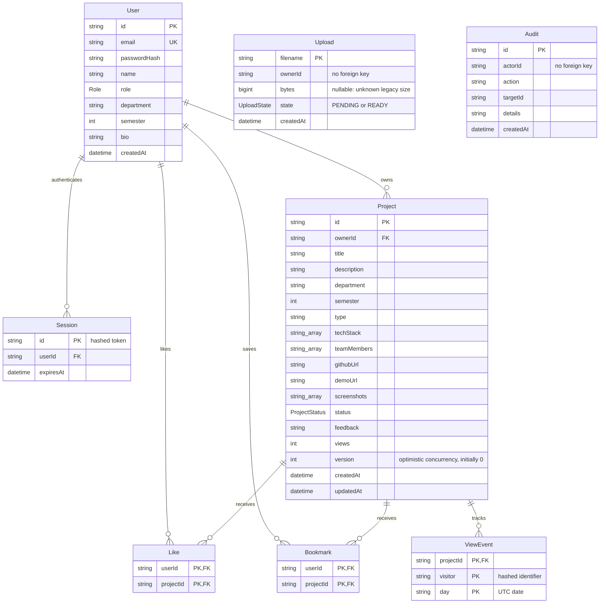

# Architecture and data model

## Request flow

Browser → Next.js (port 3000) → same-origin `/api` proxy → NestJS (port 4000) → Prisma → PostgreSQL. Uploaded images live on an API filesystem volume and are served through `/api/uploads`. Production proxy routing is configured with `API_INTERNAL_URL` during frontend build. Clients never receive database credentials.

## Entity relationships

Schema source of truth: `apps/api/prisma/schema.prisma`. Audit and Upload store identifiers without database relations. Audit retains its identifiers independently of entity lifetimes; uploaded-file cleanup must be handled separately from user/project deletion. Only READY uploads can be served; access then requires ownership/reviewer role or an approved project reference. PENDING uploads remain inaccessible even to privileged readers and cannot be attached to projects. User deletion cascades to sessions/projects/likes/bookmarks; project deletion cascades to likes/bookmarks/view events. There is no general user-deletion UI in this MVP.

## Lifecycle and authorization

- New projects start `DRAFT` with version 0. Owners can submit `DRAFT` or `CHANGES_REQUESTED` projects to `PENDING`.
- Faculty/admin approve, request changes, or hide eligible projects, but cannot review their own. Approval requires `PENDING`; requesting changes requires feedback. Public gallery returns only `APPROVED` projects.
- Every content edit returns the project to `DRAFT` and clears feedback, so public text changes require another review.
- Existing-project edits, submissions, deletions, and moderation require the client snapshot's `expectedVersion`. Conditional database writes reject stale/overlapping mutations with 409. Edits, submissions, and moderation increment the version; deletion checks it before removing the record. Passive views/likes/bookmarks do not advance it. Moderation and its audit entry commit atomically.
- Private project detail access is restricted to owner/reviewer. Students cannot set roles or moderation states through normal create/update DTOs.
- Public signup sets role `STUDENT`; only admin role-management endpoints elevate users.
- Likes and bookmarks use compound primary keys to make duplicates impossible. Daily view records have `(projectId, visitor, day)` uniqueness and update the counter transactionally.

HTTP guards/DTOs and response shaping remain in the controller; `ProjectCommands` owns authenticated content/workflow writes through a narrow persistence interface. This boundary preserves authorization, version predicates, and transaction behavior; it does not introduce another public API.

## Bounded collections

The gallery, workspace, bookmarks, moderation queue, users, and audit endpoints return `{items,total,page,limit,pages}`. Limits and query validation are defined in the [API contract](../apps/api/API-CONTRACT.md). Workspace responses also include owner-wide status totals independent of the selected page/filter. Administrator search filters name/email and role on the server before counting/paging, so older users remain reachable.

Private project and administrator collection responses use a consistent database snapshot for their items/counts and related summary/viewer flags. Separate offset-page requests are live views, not an immutable traversal; clients reload/clamp an emptied page after mutations.

## Upload reservations and storage

Uploads are decoded and normalized before reserving measured WebP bytes and one file slot under a per-user database lock. A PENDING row is charged before an exclusive file write; the row becomes READY only after the write closes. Both states consume the account quota. Uncertain writes/finalization retain reservations conservatively. Unknown legacy byte counts are not zero: existing READY images remain readable, but an unknown-size row blocks that owner's new uploads until separately authorized reconciliation.

Database transactions do not make the filesystem atomic. Crashes can leave missing/partial files or retained reservations; deleting a project/reference does not delete its uploads. Follow [upload storage operations](UPLOAD-STORAGE.md) for coordinated upgrades, inventory, quota limits, and recovery boundaries. The [fixture recovery rehearsal](RECOVERY-REHEARSAL.md) tests only a quiescent database/file pair, not a live cross-store snapshot.

## Trust boundaries

The API is authoritative. UI role-based controls are convenience, not security enforcement. DTO validation rejects unexpected properties. Session cookies are opaque random values with server-side hashed-token storage, expiry, and logout revocation. API checks exact request Origin for mutations and applies request/auth rate limits. HTTPS and secure cookies are required for non-loopback production. Raw file names and MIME labels are insufficient; uploaded image bytes are decoded and re-encoded, and only supported image formats are accepted.

Public content is intentionally readable without an account. Project titles, descriptions, screenshots, team-member names, GitHub links, and live-demo links may therefore disclose student data. Institutions must define consent, retention, and approval rules before public use. Secrets or private code must never be uploaded. This app links to external code; it does not execute or host uploaded repositories.

## Intentional MVP limitations

- Team-member names are metadata; collaborators do not receive edit permissions.
- Project progress means draft/review/publication status and reviewer feedback, not milestones or grading.
- Local uploads require a persistent volume, one shared storage location, and consistent quota settings if scaling API replicas. Per-account quotas do not cap installation-wide storage or provide retention/cleanup.
- Rate limiting is in process; use shared storage before scaling horizontally.
- View de-duplication is an approximate engagement metric, not fraud-resistant analytics.
- No email verification, password-reset delivery, SSO, MFA, notification system, account deletion workflow, or automated retention policy.
- No production SLA, penetration test, or production certification is implied by the included tests.
